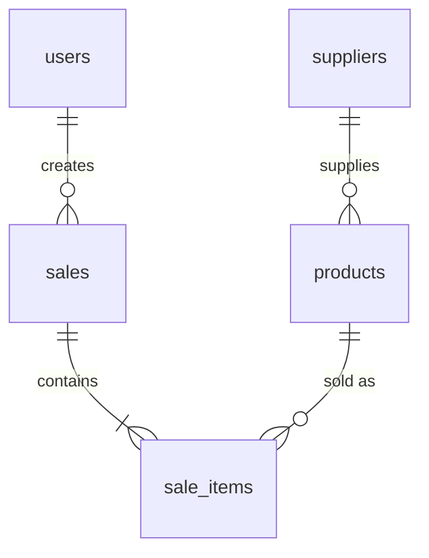

# GreenLeaf Grocers - Inventory & Sales Management

Flask + SQLite + pandas + matplotlib web app for products, stock, billing and sales reports.

## Setup
```bash
python -m venv venv
venv\Scripts\activate          # Windows   (Mac/Linux: source venv/bin/activate)
pip install -r requirements.txt
python check_setup.py          # diagnoses any problem before you start
python seed_data.py            # 53 products, 6 suppliers, 620 sales over ~6 months
python app.py                  # open http://127.0.0.1:5001
```
Demo logins: `admin / admin123` (products + reports + billing), `cashier / cashier123` (billing only).
Change the passwords and set `SECRET_KEY` before any real use.

## Run tests (32 tests, separate temp database per test)
```bash
python run_tests.py            # runs everything and writes TEST_REPORT.md
```

## Project structure
| File | Purpose |
|---|---|
| `app.py` | App factory, error pages |
| `config.py` | Settings (DB path, expiry window, upload limit) |
| `database.py` / `schema.sql` | SQLite connection and tables, keys, constraints |
| `models.py` | Users, products CRUD, CSV import, billing + stock deduction |
| `routes.py` | All pages and CSV downloads |
| `reports.py` | pandas analytics, KPIs, matplotlib charts |
| `utils.py` | Validation, role decorators, CSV helper |
| `seed_data.py` | Sample data generator (`--reset` to rebuild) |
| `tests/` | pytest suite |
| `check_setup.py` / `run_tests.py` | Setup diagnosis / test report generator |
| `DEMO_GUIDE.md` | Step-by-step demo script |

## ER diagram

Tables are in 3NF: item prices are stored on `sale_items` so old bills never change when a price changes.

## KPI definitions
- **Total revenue**: sum of bill totals (after discount) in the selected dates
- **Average bill value**: revenue / number of bills
- **Stock turnover**: units sold in period / units currently in stock
- **Low-stock items**: products with stock <= reorder level
- **Top category share**: best category's share of revenue (or quantity)

## Business rules
Negative/zero quantities, invalid dates, expired items and selling more than the stock are rejected. A bill is saved
in one transaction, so a failed bill never changes stock. Products with sales history cannot be deleted
(set stock to 0 instead) so past bills stay correct.

## Screenshots
Add your own here after running the app (login, dashboard, products, billing, reports).
